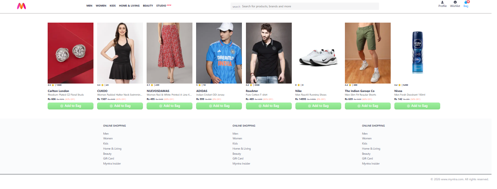
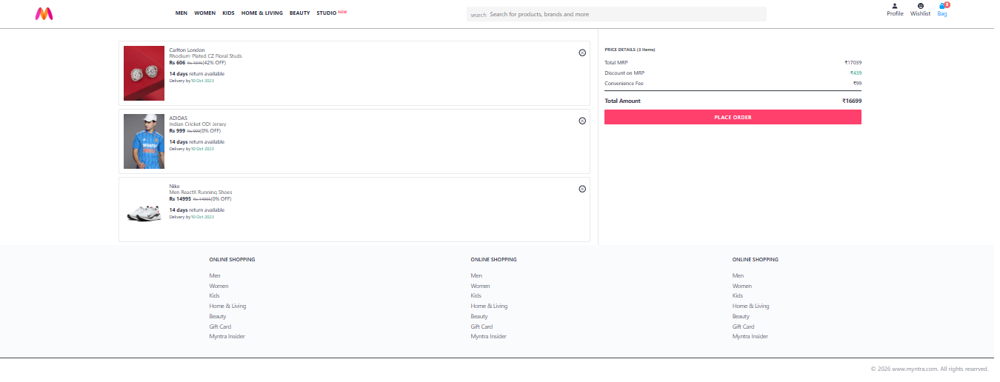

# Myntra Clone – React E-Commerce Application

A frontend-focused e-commerce web application inspired by Myntra, built using React.js and Redux Toolkit.

This project provides an online shopping experience where users can browse products, view product details, and manage their shopping bag.

## Project Overview

The application is developed to demonstrate practical implementation of React components, state management using Redux Toolkit, and dynamic UI updates.

## Key Features

- Product listing with product images and details.
- Add products to the shopping bag.
- Remove products from the shopping bag.
- Dynamic shopping bag updates using Redux Toolkit.
- Product ratings and pricing information.
- Shopping bag summary.
- Reusable React components.
- API integration to fetch product data.
- Responsive e-commerce user interface.

## Technologies Used

- HTML5
- CSS3
- JavaScript
- React.js
- Redux Toolkit
- Bootstrap
- React Icons
- Git and GitHub
- REST API

## Installation and Setup

1. Clone the repository:

   ```bash
   git clone https://github.com/sahildeoda123/myntra-clone.git
   ```

2. Navigate to the project folder:

   ```bash
   cd myntra-clone
   ```

3. Navigate to the React frontend:

   ```bash
   cd 3-myntra-react-clone
   ```

4. Install dependencies:

   ```bash
   npm install
   ```

5. Start the development server:

   ```bash
   npm run dev
   ```

## Project Structure

myntra-clone/
│
├── 1-pre-built-bundle/
│
├── 2-actual-backend/
│
├── 3-myntra-react-clone/
│
├── .gitignore
│
└── README.md

## Screenshots

### Home Page



### Shopping Bag


